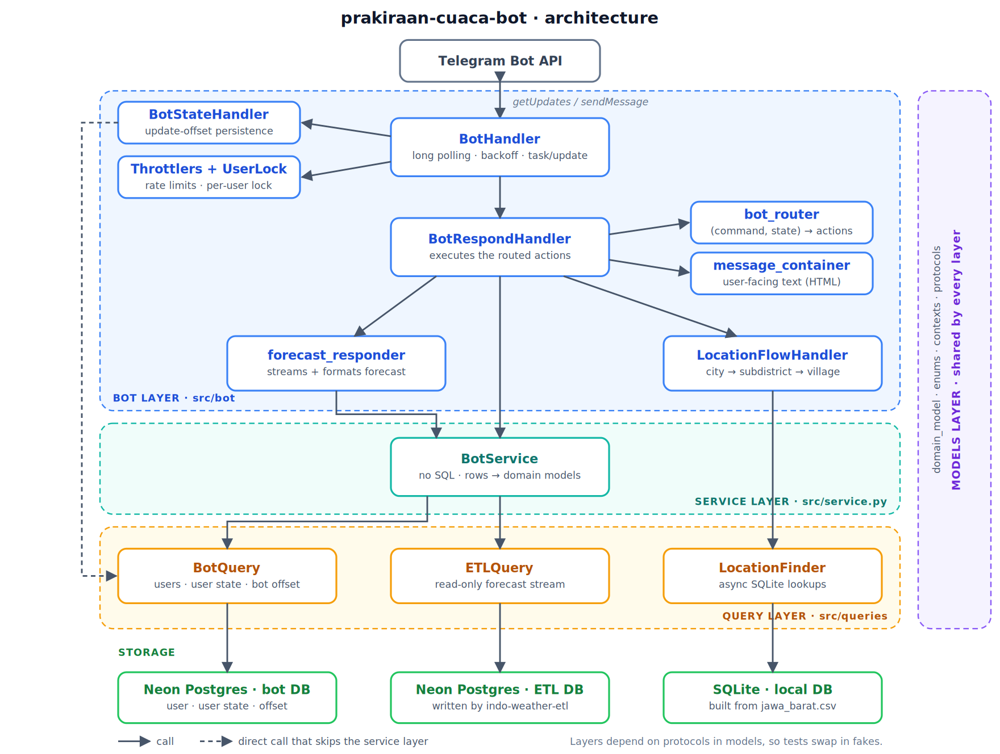

# prakiraan-cuaca-bot

A Telegram bot that provides BMKG weather forecasts for areas in Jawa Barat. It consumes the data produced by [indo-weather-etl](https://github.com/Rifki-NQ/indo-weather-etl), which runs on a server.

---

## Table of Contents

- [Installation](#installation)
- [Environment Variables](#environment-variables)
  - [Required](#required)
  - [Optional (for testing)](#optional-for-testing)
  - [Connection string format](#connection-string-format)
- [Usage](#usage)
- [Commands](#commands)
- [Testing](#testing)
  - [Full test run](#full-test-run)
  - [Unit tests only](#unit-tests-only)
  - [Integration tests only](#integration-tests-only)
  - [Production database tests](#production-database-tests)
- [Architecture Overview](#architecture-overview)
  - [Request flow](#request-flow)
  - [Query layer](#query-layer)
  - [Service layer](#service-layer)
  - [Bot layer](#bot-layer)
  - [Models layer](#models-layer)

---

## Installation

Requires Python 3.11 or newer.

```bash
# 1. Clone the repository
git clone https://github.com/Rifki-NQ/prakiraan-cuaca-bot.git

# 2. Navigate into the project directory
cd prakiraan-cuaca-bot

# 3. Create a virtual environment

# Linux / macOS
python3 -m venv .venv

# Windows
python -m venv .venv

# 4. Activate the virtual environment

# Linux / macOS
source .venv/bin/activate

# Windows
.venv\Scripts\activate

# 5. Install dependencies
pip install -e .

# (Optional) Install dev dependencies
pip install -e ".[dev]"
```

---

## Environment Variables

Copy the example file and fill in your own values:

```bash
cp .env.example .env
```

### Required

| Variable | Description |
| --- | --- |
| `ETL_DATABASE_URL` | Connection string for the PostgreSQL (Neon) database that holds the BMKG forecast data written by the ETL pipeline. |
| `BOT_DATABASE_URL` | Connection string for the PostgreSQL (Neon) database that stores bot and user state, such as each user's selected location. |
| `LOCAL_DATABASE_URL` | Connection string for the local SQLite database used for location lookups (Jawa Barat administrative areas). |
| `BOT_TOKEN` | Telegram bot token, obtained from [@BotFather](https://t.me/BotFather). |

### Optional (for testing)

This is only needed to run the integration tests. Point them at **separate** databases, never your production ones.

| Variable | Description |
| --- | --- |
| `TEST_DATABASE_URL` | PostgreSQL connection string for the test database. |

### Connection string format

```dotenv
# PostgreSQL (Neon), async driver
postgresql+asyncpg://<user>:<password>@<host>/<dbname>?ssl=require

# SQLite, async driver (note the four slashes for an absolute path)
sqlite+aiosqlite:////absolute/path/to/mydb.db
```

---

## Usage

Make sure your virtual environment is activated (see [Installation](#installation)). It needs to be activated again in every new terminal session, otherwise `run_bot` won't be found.

Start the bot with:

```bash
run_bot
```

On the first run, add the `--build-local-db` flag. The bot builds the local location database first, then starts:

```bash
run_bot --build-local-db
```

> **Notes on `--build-local-db`**
>
> - It converts the CSV file of full location data into a SQLite `.db` file, which the bot uses for user location lookups. **This step is slow and blocks startup until it finishes.**
> - The CSV must have exactly these columns: `kode_adm4`, `provinsi`, `kabupaten_atau_kota`, `kecamatan`, and `desa_atau_kelurahan`. See [`jawa_barat.csv`](adm4_codes/jawa_barat.csv) for an example.
> - `kode_adm4` is Indonesia's administrative area code, down to the village level. For the full list, see [Kode Wilayah Administrasi Pemerintahan seluruh Indonesia](https://m.nomor.net/_kodepos.php?_i=kode-wilayah).

Logs are written to the `logs/` directory.

---

## Commands

Before the bot can show a forecast, each user has to set up a location by choosing a city or regency, then a subdistrict, then a village.

| Command | Description |
| --- | --- |
| `/start` | Starts the bot. New users are asked for their city or regency, users with an unfinished setup are prompted to continue it, and users who have finished are welcomed back and shown their saved location. |
| `/help` | Shows the list of commands. Use `/help <command>` (`location`, `input`, `today`, `tomorrow`, `reset`, or `revert`) for details on one command. |
| `/location` | Continues the location setup, or shows the saved location if the setup is complete. |
| `/input <value>` | Sends a location name for the current setup step, for example `/input kabupaten bekasi`. |
| `/today` | Shows today's forecast for the saved location. |
| `/tomorrow` | Shows tomorrow's forecast for the saved location. |
| `/revert` | Goes back one level in the location setup. |
| `/reset` | Clears the saved location so the setup can start over. |

- Commands that take no value (everything except `/input` and `/help`) reply with an error if one is given, and `/input` replies with an error if the value is missing.
- `/today` and `/tomorrow` ask the user to finish the setup first if it isn't complete.
- `/reset` and `/revert` reply that there is nothing to reset or revert if the setup hasn't been started.

---

## Testing

Install the dev dependencies first:

```bash
pip install -e ".[dev]"
```

Tests are split by two pytest markers:

| Marker | Meaning |
| --- | --- |
| `integration` | Runs against a real database, so it needs `TEST_DATABASE_URL` (see [Environment Variables](#environment-variables)). |
| `prod_db` | Hits the **production** database directly. It reads and creates tables but never drops them. |

Tests without a marker are unit tests. They run against mocks in place of the databases and Telegram, because each layer depends on protocols instead of concrete classes, so they need no database setup.

### Full test run

Runs the unit and integration tests, and skips the production database tests:

```bash
pytest -m "not prod_db"
```

### Unit tests only

No databases needed:

```bash
pytest -m "not integration and not prod_db"
```

### Integration tests only

Needs the test databases to be configured:

```bash
pytest -m integration
```

### Production database tests

> **Warning:** these tests connect to the production database from your `.env`. They never drop tables, but they can create them. Run them deliberately and only when you need to.

```bash
pytest -m prod_db
```

---

## Architecture Overview

The project is split into four layers: query, service, bot, and models.



### Request flow

1. `BotHandler` long-polls Telegram for updates and turns each message into a command.
2. For each update it starts a task, and the task passes the command to `BotRespondHandler`.
3. `BotRespondHandler` asks `BotService` where the user is in the location setup, then passes the command and that state to `bot_router`, which returns the list of actions to perform.
4. The handler runs each action. Depending on the action, it uses a message from `message_container`, a step of the `LocationFlowHandler`, or a forecast from `BotService` formatted by `forecast_responder`.
5. The messages are joined into one reply and sent back to the user through the global and per-user throttlers.

The query layer sits under `BotService` and `LocationFlowHandler`, and the models layer is shared by all of them.

### Query layer

Located in [`src/queries`](src/queries), this layer owns all database query logic:

- [`bot_query.py`](src/queries/bot_query.py): handles queries related to the bot itself, such as `user`, `user_state`, and `bot_offset`.
- [`etl_query.py`](src/queries/etl_query.py): handles queries that retrieve data from the ETL database. This module is strictly read-only: it never writes or deletes data.
- [`sqlite_query.py`](src/queries/sqlite_query.py): handles location lookups using `aiosqlite`, so queries run asynchronously without blocking the event loop. A local SQLite file suits this data because locations rarely change and are only ever read, so no network round trip or hosted database is needed. It also builds the local database from the location CSV (see `--build-local-db`).

> **Why separate bot and ETL databases?** They live in separate Neon projects, and the free tier meters compute hours per project. This keeps the bot's frequent activity from consuming the ETL's compute budget, which its schedule is tuned to fit. Forecasts still depend on the ETL database, so if it runs out of compute hours, forecast replies fail until the quota resets.

### Service layer

Located in [`src/service.py`](src/service.py), this layer sits between the bot's handlers and the query layer. It contains no SQL. It calls the query layer through protocols (`ETLQueryProtocol` and `BotQueryProtocol`, injected through the constructor so they can be swapped with fakes in tests), converts the raw rows it gets back into domain models, and holds the logic that sits between the two. Location lookups don't go through this service: they are handled by `LocationFlowHandler` and the SQLite query layer.

`BotService` is responsible for:

- **User and user state:** creating, updating, and fetching users and their state via `bot_query`. Rows are mapped into `BotUserModel` and `BotUserStateModel`, and `None` is returned when nothing is found.
- **Location state resolution:** `resolve_user_location_state` works out where a user is in the location-selection flow from which fields are filled in (`NO_STATE`, `NO_CITY_OR_REGENCY`, `NO_SUBDISTRICT`, `NO_VILLAGE`, or `COMPLETE`). It returns that state together with the user state as a `BotUserStateContext`.
- **Weather forecasts:** fetching today's or tomorrow's forecast for an `adm4_code`. It builds the date range in the bot's timezone (`BOT_DATETIME`), reads the matching rows from `etl_query`, and streams them as `ForecastModel` objects through an async iterator. It yields control to the event loop between rows so a large result doesn't block other tasks.

### Bot layer

Located in [`src/bot`](src/bot), this layer sits at the top of the stack and handles all of the Telegram bot logic:

- [`bot_handler.py`](src/bot/bot_handler.py): orchestrates the bot at runtime. It runs the long-polling loop, persists the update offset, retries with exponential backoff when the network is unstable, and starts and stops the throttlers. Each incoming update is parsed and validated into a command, then processed in its own task with concurrency bounded by a semaphore. The command logic itself is delegated to the respond handler. Replies are sent with retries on timeouts and Telegram rate limits, and errors caused by bad input (empty text, not a command, unknown command) are sent back to the user. On shutdown, it stops polling, waits for in-flight tasks to finish, and stops the throttlers.
- [`bot_respond_handler.py`](src/bot/bot_respond_handler.py): turns a command into a reply by orchestrating the bot service and the location flow handler. It gets the user's location state from the bot service and passes it with the command to the bot router, which decides the list of actions to perform. The handler then executes each action (returning a message template, running a location flow step, or fetching forecasts) and joins the messages into a single reply. It also saves the results of the location flow and recovers from data integrity errors. If a user's data is missing, it tries to restore it from their saved user state, and if that fails it resets the user's data and re-raises the error.
- [`bot_router.py`](src/bot/bot_router.py): maps a command to the bot actions it should trigger. Each command is registered as an `ActionEntry` (from [`domain_model.py`](src/models/domain_model.py)), and the entries are indexed in a dictionary by `(command, user_state, has_input_value)` for O(1) lookups. `route_command` looks up the exact combination first, then falls back to the entry registered with `user_state=None`, which means the command doesn't depend on the user's location state. It returns the matching tuple of `BotAction`s, or raises `ActionRegistryLookupError` if nothing matches.
- [`location_flow_handler.py`](src/bot/location_flow_handler.py): guides the user through the location setup (city or regency, then subdistrict, then village) using the location finder. Each input is checked against the valid options. A match advances the user's state and prompts for the next level, while a miss replies with the list of valid choices. Once the village is chosen, it looks up the `adm4_code` and marks the setup as complete. It can also revert the state by one level. It only returns the new state and reply message and doesn't save anything, so the caller persists the result. If a user's saved state is missing or inconsistent, it raises a `DataIntegrityError` asking them to re-enter their location.
- [`forecast_responder.py`](src/bot/forecast_responder.py): builds the forecast reply for a user. It takes a forecast source (the service's today or tomorrow method), streams the forecasts for the user's `adm4_code`, and formats them into a single message with a header (location code and date) followed by one entry per forecast time. If no forecasts exist for the requested range, it raises a `NoForecastResultError` with a user-friendly message.
- [`bot_respond_throttler.py`](src/bot/bot_respond_throttler.py): contains two throttlers that delay outgoing replies for different reasons:
  - `GlobalRespondThrottler` limits how many messages the bot sends across all chats within each time window, so Telegram doesn't rate-limit the bot. When the limit is reached, further sends wait until the next reset.
  - `UserRespondThrottler` enforces a cooldown between replies to the same user, so one user spamming commands can't flood the bot. Replies to that user are spaced out, while other users aren't affected.

  Both delay replies instead of dropping them, and both run a background task (a counter reset for the global throttler, stale data cleanup for the user throttler) that must be started before use and stopped on shutdown.
- [`bot_state_handler.py`](src/bot/bot_state_handler.py): reads and saves the bot's Telegram update offset through `bot_query`, so polling can resume after a restart. Saves are throttled to once every 30 seconds to avoid writing to the database after every poll, so after a crash the bot may reprocess a few recent updates.
- [`bot_user_lock.py`](src/bot/bot_user_lock.py): provides a per-chat `asyncio.Lock` so requests from the same chat are handled one at a time (later ones wait their turn) instead of concurrently, preventing corrupted state. Requests from different chats still run in parallel. Locks are stored in a [`weakref.WeakValueDictionary`](https://docs.python.org/3/library/weakref.html#weakref.WeakValueDictionary), so a lock is discarded automatically once no request is holding or waiting on it
- [`bot_utils.py`](src/bot/bot_utils.py): small shared helpers for the bot layer. `get_user_data_or_raise` checks that a user and their `adm4_code` exist, and otherwise raises a `DataIntegrityError` that asks the user to re-enter their location. `merge_messages` joins several message strings into one reply, separated by blank lines.
- [`message_container.py`](src/bot/message_container.py): holds every user-facing message as constants or small formatter functions. This covers the intro, help texts, location prompts and confirmations, error replies, and the forecast layout. Messages use Telegram's HTML formatting.

### Models layer

Located in [`src/models`](src/models), this layer holds the shared data types and interfaces used across the bot. It imports nothing from the other layers, so the service, query, and bot layers can all depend on it without circular imports.

- [`domain_model.py`](src/models/domain_model.py): dataclasses that represent the bot's data.
  - `ForecastModel`, `BotUserModel`, and `BotUserStateModel` mirror the rows returned by the query layer. `BotUserStateModel` uses Indonesian field names (`kabupaten_atau_kota`, `kecamatan`, `desa_atau_kelurahan`) that match Indonesia's administrative divisions: regency or city, subdistrict, and village.
  - `DatetimeModel` derives the start and end of a day from a given datetime, which is used to build forecast date ranges.
  - `CSVLocationDataModel` normalizes location names to lowercase.
  - `LocationFlowResult` and `LocationFlowResultComplete` carry the outcome of a location setup step (reply message, new user state, and the `adm4_code` once setup is complete).
  - `ActionEntry` is a frozen dataclass used to register commands in the bot router.
- [`enums.py`](src/models/enums.py): fixed sets of values the bot works with. `Commands` lists the supported commands, `BotAction` lists the actions the router can request, and `UserLocationState` tracks how far a user is in the location setup. `UserStateCheckLevel` is an `IntEnum` so levels can be compared when validating how much of a user's state is filled in. `UserDataRestorationResult` is the outcome of an attempt to restore missing user data.
- [`contexts.py`](src/models/contexts.py): small dataclasses that group related values. `ETLDBContext`, `BotDBContext`, and `LocalDBContext` each bundle a database engine with its tables, while `BotUpdateContext` and `BotUserStateContext` bundle the parsed update and the resolved location state that get passed between the bot and service layers.
- [`protocols.py`](src/models/protocols.py): `typing.Protocol` interfaces for the query, service, handler, throttler, and location finder classes. Classes depend on these interfaces instead of on each other directly, so the real implementations can be swapped for fakes in tests and the dependencies are checked by mypy.
